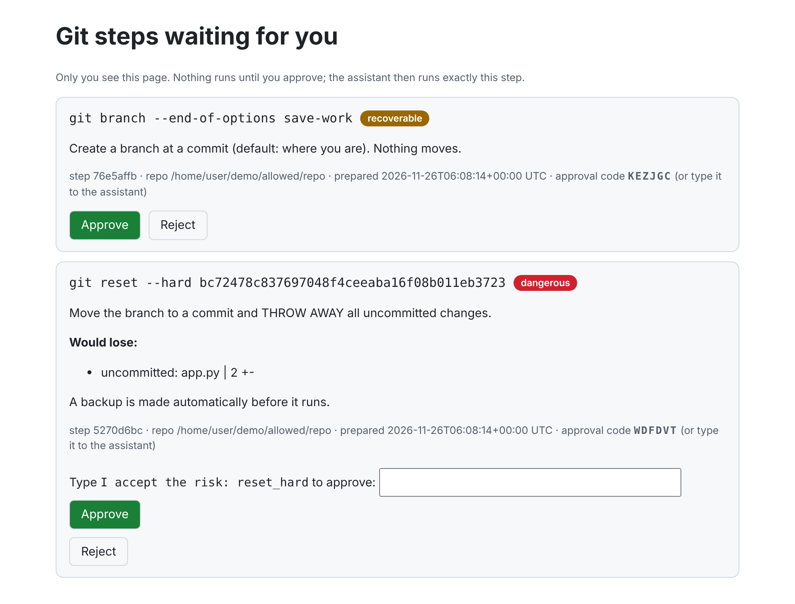

# Approval page: design (off by default, waiting for review)

**Status:** a working prototype with 9 tests. It is **not wired in**: `server.py` starts it only
when `GIT_APPROVAL_UI=1`. Without that, approval works exactly as before: git-local prints the
code to its console and to `logs/approvals.log`, and you type it to the assistant.

## The problem it solves
Every write step needs your approval code. Today the code only shows up in the server's console
and a log file. You have to go and find it there, then type it into the chat. A button next to
the exact command is quicker, and it's harder to approve the wrong step by mistake.

## What you see


One card per step the assistant prepared, newest last. The page refreshes every 4 seconds.
- **Command** in large monospace, with its **risk tier** as a coloured badge: safe (green),
  careful (amber), destructive (red).
- **Explanation** in plain words: what the step does and why.
- **Would lose** (destructive steps only): a list of what goes away, plus "a backup is made
  automatically before it runs".
- **Meta line:** step id, repo, time prepared, and the approval code (for anyone who'd rather
  type it).
- **Buttons:** Approve and Reject. A destructive step also needs its confirmation phrase typed in
  a box before Approve works.
- After you approve, the card says "Approved: the assistant can run it now". The assistant runs
  it with `execute_step(step_id)`, once only.

## Flow
1. The assistant calls `prepare_step`. The model gets a `step_id` and the plain explanation,
   never the code and never the page address.
2. The step appears on the page.
3. You click **Approve** or **Reject**. The click happens in the server process itself, so
   nothing is handed over through a file or the chat.
4. The assistant polls `step_status(step_id)`, which returns `pending`, `approved`, `rejected` or
   `used`. Once it's approved, the assistant calls `execute_step(step_id)`.
5. A step works once, only for the repo state it was prepared for. Three wrong codes cancel it.

## Why it's safe
- **Reachable only from this computer:** it listens on 127.0.0.1 only.
- **Secret address:** a random 32-character path. Any other path returns 404.
- **Host header checked:** it must be `127.0.0.1:<port>` or `localhost:<port>`. This stops a
  web page from reaching the server through DNS rebinding.
- **Origin checked on POST:** a form submitted from another website gets 403.
- **Strict headers:** CSP allows no scripts at all, `X-Frame-Options: DENY`, `no-store`,
  `Referrer-Policy: same-origin` (`no-referrer` would make browsers send `Origin: null` on the page's own forms).
- **Everything escaped:** commit messages and branch names are HTML-escaped (tested with
  `<script>`).
- **No approval tool for the model:** the MCP tools expose `step_status` only (tested).

## Not decided yet (your review)
1. **Turn it on by default?** This is the only wiring step. It means changing the default in
   `server.py`.
2. **Where to show the address.** Today it goes to stderr and `logs/approvals.log`. A desktop
   notification or opening the browser by itself would be friendlier, but it's one more moving
   part.
3. **Refresh every 4 s, or a manual refresh button?** The page has no JavaScript on purpose; the
   CSP forbids it.
4. **Batch approve** for a run of safe steps? This is left out on purpose: one click per step
   keeps you reading each command.

## Try it
```
GIT_APPROVAL_UI=1 python -m mcp_servers.git_local.server
```
The page address is printed on the first line of stderr. Tests: `pytest tests/test_approval_ui.py`.
